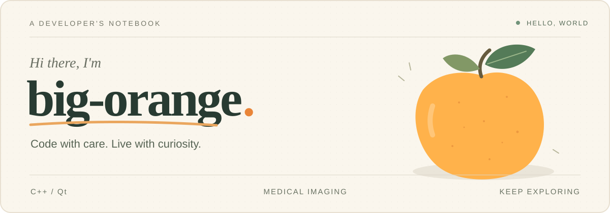
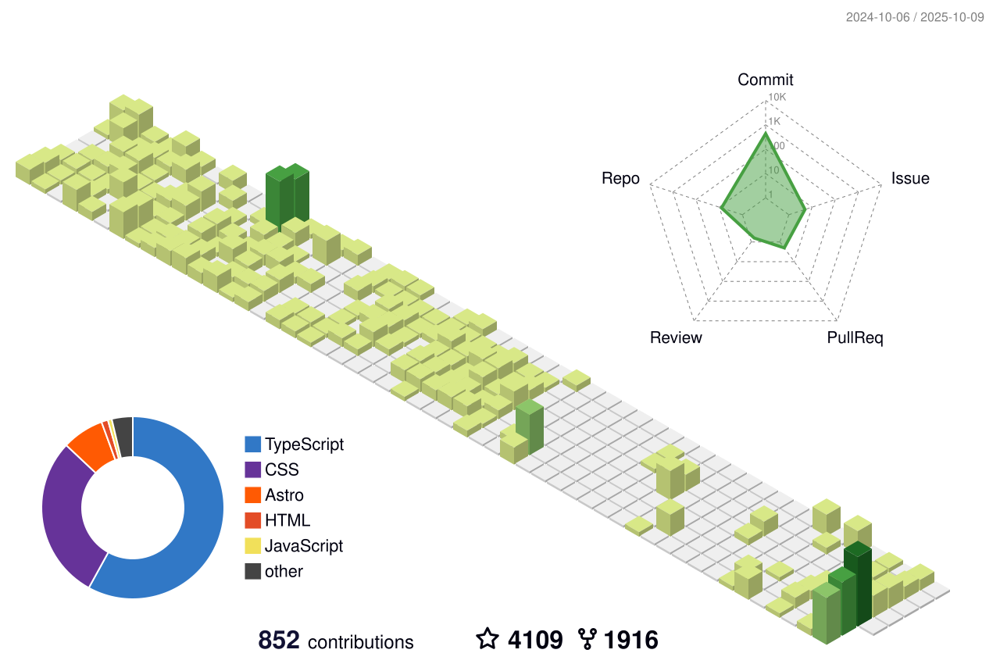

<!--
 * @Author: royal-killer hca90298@gmail.com
 * @Date: 2025-05-11 18:14:48
 * @LastEditors: royal-killer hca90298@gmail.com
 * @LastEditTime: 2026-07-21
 * @FilePath: \bigorange18\README.md
 * @Description: 
 * 
 * Copyright (c) 2025 by ${git_name_email}, All Rights Reserved. 
-->

  

  <strong>C++ / Qt 开发工程师</strong> 
  医疗影像与医疗设备软件

  <em>屏幕前的生活，不是你我的全部。</em>

  
  
  

---

## 工作经历

### 常州博恩中鼎医疗科技有限公司

**C++ / Qt 开发工程师** · `2026.05 — 至今`

> 口腔 CBCT 医学影像 · 牙体分割与根管诊疗 · 二维 / 三维交互

**技术栈**　`C++14` · `Qt` · `ITK` · `VTK`

#### Bondream3D · 口腔医学影像平台

参与口腔 CBCT 影像平台研发，围绕二维切片、三维模型与临床诊疗工具开展功能开发和交互优化。

- **髓易诊与牙体分析**：负责髓易诊功能迭代，完成牙体组织分割结果展示、手动 / 自动测量和开髓模拟；实现 MPR 动态切片、分割模型筛选及二进制 STL 合并导出。
- **根管诊疗与多视图联动**：参与根管诊疗模块建设，实现全景与牙位联动、根尖局部重采样、颊舌 / 近远中方向切片和根尖投影标记，支持从整体牙列到局部根尖的影像观察。
- **影像显示与操作工具**：集成 MPR / MIP / minIP 显示模式，以及层厚调节、滤镜和截图等控制能力，完善诊疗过程中的影像浏览与操作。
- **状态管理与渲染优化**：优化模块状态隔离和视图渲染性能，处理重复进入后状态丢失、根管与全景滑窗互相影响、上下牙切片方向异常等问题。
- **临床辅助与显示适配**：完善测量颜色、神经管编辑、独立牙冠预览插入及种植报告 PDF 预览，并处理 4K 显示与跨屏窗口交互问题。

---

### 河南翔宇医疗设备股份有限公司

**Qt 开发工程师** · `2025.12 — 2026.05`

> 嵌入式医疗设备 · 肌电信号处理 · 本地通信与远程控制

**技术栈**　`嵌入式 Linux` · `Qt 5` · `Qt Widgets` · `QML` · `MQTT` · `TCP` · `串口`

#### 肌电反馈刺激仪 · 上位机软件

基于嵌入式 Linux 开发肌电反馈刺激仪上位机，负责项目框架、人机交互界面与设备通信模块。

- **框架与界面开发**：使用 Qt Widgets 与 QML 完成人机交互界面开发，结合设备操作需求组织上位机功能与交互流程。
- **肌电信号处理**：使用 IIR 数字滤波器处理肌电信号，通过 RMS 算法计算有效值，为实时反馈刺激提供数据支持。
- **设备互联与远程控制**：通过 TCP、串口实现上位机与下位机通信；集成 MQTT，支持基于 4G 网络的远程参数上报、指令下发与远程锁机。
- **检验文档与产品配合**：编写软件型式检验相关文档，配合产品完成型式检验。

---

### 南京康友医疗科技有限公司

**Qt 开发工程师** · `2023.07 — 2025.12`

> 医疗软件研发与维护 · 医学影像处理 · 双目视觉穿刺导航

**技术栈**　`C++` · `Qt` · `C# / WPF` · `CMake` · `ITK / VTK / DCMTK` · `OpenCV` · `ONNX`

参与医疗软件全生命周期研发与维护，项目覆盖病例管理、医学影像平台与视觉导航原型。

#### 医学影像平台

- **影像处理与平台功能**：基于 C++、Qt 和 CMake 参与平台开发，使用 ITK / VTK / DCMTK 完成 DICOM 数据处理、影像分割、三维重建和患者管理相关功能。
- **算法集成与模型部署**：参与影像算法集成，并实践 ONNX 模型部署，将模型推理能力与医学影像软件结合。

#### 双目视觉穿刺导航原型

- **实验与视觉处理**：协助实验支架搭建及相机选型，使用 Qt、OpenCV 处理双目数据。
- **导航功能集成**：参与器械跟踪和呼吸门控相关功能集成，支持穿刺导航原型研发。

#### 微波消融病例管理系统

- **桌面应用开发**：使用 C#、WPF 开发微波消融病例管理系统。
- **设备对接与协议解析**：对接 USB-CAN 设备，完成通信协议解析、位运算和字节处理，实现软件与设备间的数据交互。

---

## 技术栈 · 专业方向

### 核心开发

`C++ / C++14`　`Qt 5`　`Qt Widgets`　`QML`　`CMake`　`C# / WPF`

桌面与嵌入式 Linux 上位机开发，涵盖交互界面、设备接入和医疗软件功能集成。

### 医学影像与三维可视化

`ITK`　`VTK`　`DCMTK`　`DICOM`　`STL`

- **数据与模型**：DICOM 数据处理、影像分割、三维重建、分割模型筛选与 STL 合并导出。
- **切片与交互**：MPR 多平面重建、MIP / minIP 投影、局部重采样、多视图联动和影像测量。

### 计算机视觉与模型集成

`OpenCV`　`ONNX`

双目视觉数据处理、器械跟踪、呼吸门控功能集成，以及 ONNX 模型部署与影像算法集成。

### 信号处理与设备通信

`IIR`　`RMS`　`MQTT`　`TCP`　`串口`　`USB-CAN`

- **信号处理**：肌电信号数字滤波与 RMS 有效值计算。
- **设备通信**：通信协议解析、位运算与字节处理，上下位机数据交互。
- **远程控制**：基于 4G 网络的参数上报、指令下发与远程锁机。

## About My GitHub

  

<picture>
  <source media="(prefers-color-scheme: dark)" srcset="./profile-snake-contrib/github-contribution-grid-snake-dark.svg" />
  <source media="(prefers-color-scheme: light)" srcset="./profile-snake-contrib/github-contribution-grid-snake.svg" />
  
</picture>

## Games · 游戏画廊

  
  
  

  黑神话：悟空 · 荒野大镖客：救赎 2 · 空洞骑士

## Favorite❤️Movie

  

  <strong>阿甘正传 · Forrest Gump（1994）</strong> 
  Life is like a box of chocolates. You never know what you're gonna get.

---

感谢来访，愿你的代码少些 Bug，生活多些精彩。

